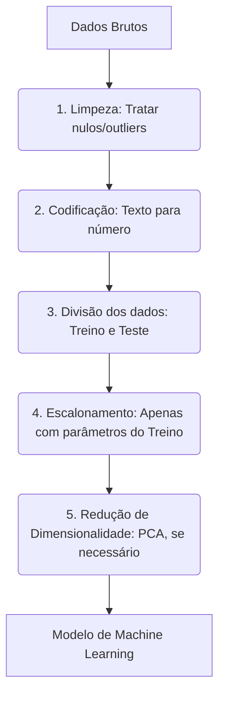

# Machine Learning

O **Machine Learning** (ou aprendizado de máquina) é um subcampo da Inteligência Artificial que permite aos sistemas computacionais aprenderem e melhorarem com a experiência (através de dados) de forma autônoma, sem precisarem de programação explícita para cada regra.

Aprenda mais sobre os fundamentos iniciais na [Introdução aos conceitos de Machine Learning](https://learn.microsoft.com/pt-br/training/modules/fundamentals-machine-learning/) da Microsoft.


## Conceitos Fundamentais

- **Algoritmo vs. Modelo**: Um **algoritmo** é o conjunto de regras e procedimentos matemáticos usados para resolver um problema (ex: regressão linear, árvore de decisão). Já o **modelo** é o resultado gerado após aplicar esse algoritmo a um conjunto de dados.
- **Dados de Treinamento**: O volume de dados usado para ensinar o algoritmo a reconhecer padrões e ajustar seus parâmetros internos.
- **Generalização**: A capacidade que um modelo treinado tem de acertar previsões ou identificar padrões em **dados novos** que ele nunca viu antes.


## Principais Tipos de Aprendizado

- **Aprendizado Supervisionado**: O modelo é treinado usando dados rotulados (ou seja, a entrada já tem a resposta correta associada, como mostrar fotos e dizer quais são de "gatos" e "cachorros").
- **Aprendizado Não Supervisionado**: O algoritmo recebe dados sem rótulos e precisa descobrir por conta própria as estruturas ocultas, semelhanças ou agrupamentos (ex: segmentação de clientes ou detecção de anomalias).
- **Aprendizado por Reforço**: O sistema aprende por tentativa e erro, recebendo recompensas por acertos e penalidades por erros, muito usado em robótica e jogos.

## Tecnologias e Ramificações

- **Redes Neurais**: Arquiteturas inspiradas no cérebro humano que aplicam múltiplas camadas de transformações para capturar padrões complexos e não lineares nos dados.
- **Deep Learning (Aprendizado Profundo)**: Um subcampo avançado do Machine Learning baseado em redes neurais profundas com muitas camadas, ideal para lidar com grandes volumes de dados não estruturados, como imagens e áudio.
- **Processamento de Linguagem Natural (PNL)**: Área focada na interação entre computadores e a linguagem humana (texto e fala).

---

|**Tarefa**	|**Tipo de Aprendizado**|	**Objetivo Principal**|	**Exemplo Prático**|
|---|---|---|---|
|**Classificação**|	Supervisionado|	Prever uma categoria ou rótulo discreto.|	Identificar se um e-mail é Spam ou Não Spam.|
|**Regressão**	|Supervisionado|	Prever um valor numérico contínuo.	|Estimar o preço de uma casa com base no tamanho.|
|**Clusterização**	|Não Supervisionado|	Agrupar dados semelhantes sem rótulos prévios.	|Dividir clientes em grupos de consumo diferentes.|


#### Estes três conceitos representam as tarefas fundamentais do Machine Learning para resolver problemas e fazer previsões a partir de dados.

### 1. Classificação (Classification)

O algoritmo analisa os dados históricos para aprender a separar as informações em grupos ou classes predefinidas. A resposta final é sempre uma escolha entre opções (sim/não, A/B/C).
- **Algoritmos comuns**: Regressão Logística, Árvores de Decisão, Random Forest, Máquinas de Vetores de Suporte (SVM).
- **Aplicações**: Diagnóstico médico (Doente / Saudável), aprovação de crédito (Aprovado / Recusado), reconhecimento de objetos em fotos (Carro, Pedestre, Placa).

### 2. Regressão (Regression)

Em vez de categorizar, a regressão busca entender a relação entre variáveis para prever um número exato na linha do tempo ou em uma escala numérica.
- **Algoritmos comuns**: Regressão Linear, Regressão Polinomial, Ridge/Lasso Regression.
- **Aplicações**: Previsão do faturamento de uma empresa no próximo mês, estimativa de temperatura, cálculo do tempo de entrega de um delivery.

### 3. Clusterização ou Agrupamento (Clustering)

Aqui o computador não sabe o que está procurando. Ele analisa as características dos dados e junta o que é parecido, separando o que é diferente. Não existem respostas "certas" ou "erradas" predefinidas.
- **Algoritmos comuns**: K-Means, DBSCAN, Agrupamento Hierárquico.
- **Aplicações**: Sistemas de recomendação (agrupar filmes parecidos na Netflix), identificação de regiões com maior índice de criminalidade, separação de documentos por temas.


## Avaliação de Modelos

- Como Saber se o Modelo Funciona Bem? Modelo que tenta prever se vai chover.
    - ### Exemplo de Previsão de Chuva
        - Situação do exemplo:
            
            ```text
                Total de dias: 90

                Dias de chuva: 10

                O modelo sempre diz que não vai chover.

                Dias sem chuva (ensolarados): 80
            ```

## Avalição

- **Acurácia**: mostra quantas vezes o modelo acertou.
    - ### Cálculo da acurácia:
$$ \mathbf{Acurácia} = \frac{\text{número de acertos}}{\text{total de tentativas}} = \frac{80}{90} \approx 88,88\% $$
<br>

- Arredondando, dá aproximadamente **89%**.
- **Precisão** e **Recall** ajudam a entender melhor.

## Avaliação de Modelos

### Exemplo de Previsão em Sala de Aula

Image que temos 100 alunos. A escola quer um modelo para prever quem vai faltar em um determinado dia.

- Em média, **10 alunos faltam** por dia.
- O modelo **sempre diz que todos vão comparacer**.

#### O que o modelo acerta:

- Ele acerta **90 vezes**, porque realmente **90 alunos foram á aula**.

#### O que ele erra:

- Ele erra **10 vezes**, porque **10 alunos faltaram** e o modelo disse que estariam presentes.

- ### Cálculo da acurácia

$$ \mathbf{Acurácia} = \frac{\text{90 acertos}}{\text{100 alunos}} = 90\% $$

### O Problema:

- Ele **nunca acerta uma falta**.
- Por isso, que além da acurácia, usamos **precisão** e **recall**

--- 

# Recall vs. Precisão em Machine Learning

## Recall (Revocação)

- "Capturar todos os positivos!"
- **Fórmula**: `Verdadeiros Positivos / (Verdadeiros
Positivos + Falsos Negativos)`
- **Exemplo**:
    - 10 pessoas têm doença → modelo detecta 8.
    - **Recall** = **80%** (falhou em 2 casos).

- **Quando priorizar?**
    - Diagnóstico médico, fraudes (evitar falsos negativos).

## Precisão (Precision)

- "Só marcar positivo se for certeza!"
- **Fórmula**: `Verdadeiros Positivos / (Verdadeiros
Positivos + Falsos Positivos)`
    - **Exemplo**:
        - Modelo diz que 5 têm doença → 4 estão corretos.
        - **Precisão** = **80%** (1 alarme falso).

- **Quando priorizar?**
    - Spam, crédito bancário (evitar falsos positivos).

## Precisão vs. Recall

|**Métrica**| **Vantagem**| **Desvantagem**|
|---|---|---|
|**Recall**|Não deixa positivos escaparem | Pode ter falsos positivos|
|**Precisão**| Minimiza erros nos positivos | Pode perder casos reais|

# Seleção de Atributos

- Remove o que não importa

## Exemplos práticos: 

1. **Modelo de Aprovação de Crédito**
    - **Importante**: Salário, histórico de pagamentos, dívidas.
    - **Inútil**: Cor favorita, signo, time de futebol.
2. **Análise de Texto (como detectar um spam)**
    - **Importante**: Palavras como "oferta", "grátis", "urgente".
    - **Inútil**: "o", "e", "de" (não ajudam a diferenciar um e-mail normal de um spam).

## Por que isso é útil?

### PCA (Análise de Componentes Principais)

- Reduz a complexidade
- Mantém o que importa


### Os Três Pilares do PCA

Para entender como o PCA transforma os dados, pense em três conceitos fundamentais:

- **Variância como Informação**: Em estatística, quanto maior a variação dos dados em um eixo, mais informação esse eixo carrega. O PCA busca as direções onde os dados estão mais espalhados.
- **Componentes Principais (PCs)**: São as novas variáveis criadas. O **PC1** é o eixo que captura a maior variação possível dos dados. O **PC2** é perpendicular (ortogonal) ao PC1 e captura a segunda maior variação, e assim por diante.
- **Ortogonalidade**: Todos os novos componentes criados são totalmente independentes entre si. Isso significa que a correlação entre eles é rigorosamente **zero**.


## Pré-processamento dos dados

O **pré-processamento** de dados é a etapa mais crítica de um projeto de Machine Learning.

Ele consiste em limpar, transformar e organizar os dados brutos para que os algoritmos de IA possam aprender de forma eficiente. Dados de má qualidade geram modelos de má qualidade (o famoso conceito de "*Garbage In*, *Garbage Out*").

Para aplicar técnicas como o **PCA** que vimos antes, o pré-processamento é obrigatório. Abaixo estão as etapas essenciais divididas por objetivos.


### 1. Limpeza dos Dados (Data Cleaning)

Nesta etapa, removemos ruídos e inconsistências que confundem os modelos:

- **Tratamento de Valores Ausentes (Missing Data)**: Decidir se as linhas vazias serão excluídas ou preenchidas (imputação) usando a média, mediana, moda ou algoritmos mais complexos como KNN.
- **Remoção de Duplicatas**: Eliminar registros idênticos para evitar pesos artificiais no treinamento.
- **Tratamento de Outliers**: Identificar valores discrepantes (erros de digitação ou anomalias reais) e decidir se serão removidos, transformados ou mantidos.

### 2. Transformação e Escalonamento (Scaling)

Os algoritmos baseados em distância (como KNN, SVM, K-Means e o próprio PCA) exigem que os dados estejam na mesma escala jurídica.

- **Padronização (Standardization / StandardScaler)**: Transforma os dados para terem média 0 e desvio padrão 1. É ideal para o **PCA** e modelos que assumem uma distribuição normal.
- **Normalização (Normalization / MinMaxScaler)**: Redimensiona todos os valores para um intervalo fixo entre 0 e 1. É muito usada em redes neurais e processamento de imagens.

### 3. Codificação de Variáveis Categóricas (Categorical Encoding)

Computadores só entendem números. Textos e categorias precisam ser convertidos:
- **One-Hot Encoding**: Cria colunas binárias (0 ou 1) para cada categoria. Ideal para dados nominais (ex: Cores: Vermelho, Azul, Verde) onde não existe ordem entre eles.
- **Ordinal Encoding**: Converte categorias em números sequenciais (1, 2, 3). Ideal para dados ordinais onde a ordem importa (ex: Escolaridade: Fundamental, Médio, Superior).

### 4. Engenharia e Redução de Recursos (Feature Engineering & Reduction)

- **Seleção de Recursos (Feature Selection)**: Filtragem e escolha manual ou automatizada das colunas mais importantes para o modelo.
- **Extração de Recursos (Feature Extraction)**: Criação de novas variáveis combinando as antigas. É aqui que entra o **PCA**, reduzindo dezenas de colunas correlacionadas em apenas alguns componentes principais.

## A Ordem Correta do Fluxo (Pipeline)

Para evitar vazamento de dados (*data leakage*) e erros no modelo, o fluxo ideal segue esta sequência:



# Associação de regras

A **relação de associação** (ou **Mineração de Regras de Associação**) é uma técnica de machine learning não supervisionado utilizada para descobrir padrões ocultos, conexões e relações de dependência entre itens em grandes conjuntos de dados.

O exemplo clássico é o **Algoritmo Apriori** aplicado à "Análise de Cesta de Compras" em supermercados, que permite descobrir regras como: "**Se um cliente compra pão e manteiga, ele também tem 80% de chance de comprar leite**."


## As 3 Métricas Fundamentais

Para saber se uma regra de associação é forte e confiável, o algoritmo calcula três métricas estatísticas baseadas na frequência com que os itens aparecem juntos:

- **Suporte (Support)**: Mede a popularidade de um conjunto de itens. É a proporção de transações que contêm os itens analisados.

$$\text{Suporte}(A\rightarrow B) = \frac{\text{Transações contendo } A \text{ e } B}{\text{Total de transações}}$$

- **Confiança (Confidence)**: Mede a certeza da regra. É a frequência com que o item B é comprado dado que o item A já foi comprado.

$$\text{Confiança}(A\rightarrow B) = \frac{\text{Suporte}(A\text{ e } B)}{\text{Suporte}(A)}$$

- **Lift (Alavancagem)**: Mede a força da regra em relação ao acaso. Um Lift maior que 1 significa que a compra do item A aumenta consideravelmente a chance da compra do item B. Se o Lift for 1, os itens são independentes.

$$ \text{Lift}(A\rightarrow B) = \frac{\text{Confiança}(A\rightarrow B)}{\text{Suporte}(B)} $$


## Principais Algoritmos

- **Apriori**: O mais famoso e intuitivo. Ele usa uma abordagem de "baixo para cima", assumindo que se um conjunto de itens é frequente, todos os seus subconjuntos também são. Pode se tornar lento em bases de dados massivas porque lê os dados repetidas vezes.
- **FP-Growth (Frequent Pattern Growth)**: Uma alternativa muito mais rápida que o Apriori. Ele compacta o banco de dados em uma estrutura de árvore na memória (FP-Tree), eliminando a necessidade de escanear repetidamente os dados.

## Aplicações no Mundo Real

- **E-commerce e Varejo**: Criação de sistemas de recomendação ("Quem comprou este item também comprou...") e organização física de produtos nas prateleiras para aumentar vendas cruzadas (*cross-selling*).
- **Streaming e Conteúdo**: Recomendação de filmes, séries ou músicas com base em playlists e históricos compartilhados por usuários com perfis similares.
- **Saúde e Medicina**: Identificação de sintomas que costumam ocorrer juntos para auxiliar no diagnóstico de síndromes complexas ou prever efeitos colaterais de combinações de medicamentos.
- **Segurança Digital**: Análise de logs para detectar padrões de acessos que costumam anteceder ataques cibernéticos ou invasões.


