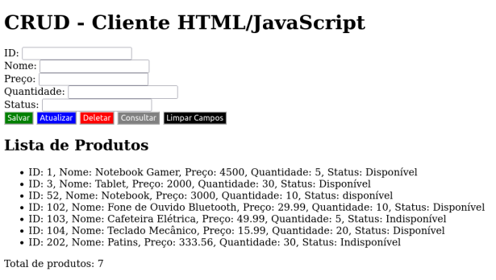

# Integração de Aplicações Externas

**Integração de Spring Boot com HTML e JavaScript.**

### Exemplo: Página de Listagem:

---

### Exemplo: Página de Erro

--- 

# Integração de Aplicações Exeternas - CRUD

### Exemplo: Página de Listagem

## CRUD - Cliente HTML/JavaScript

